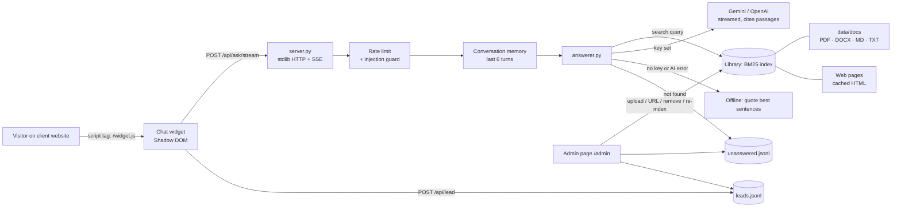
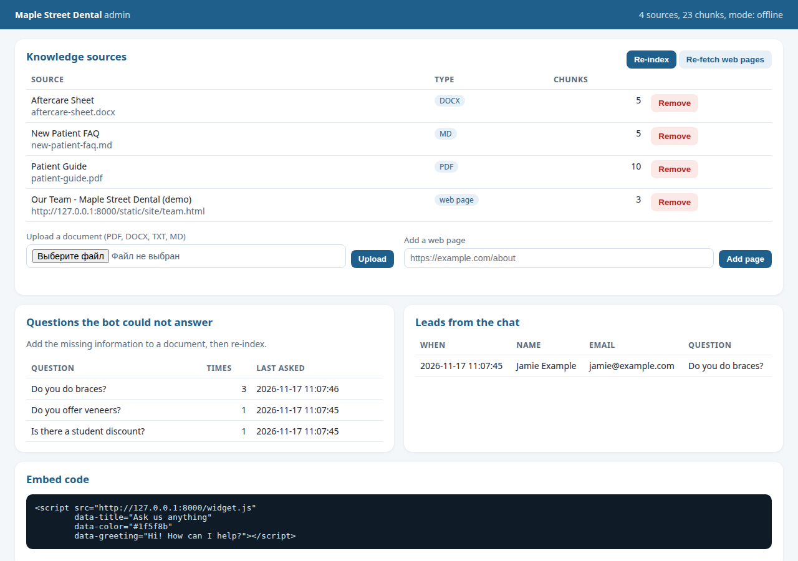
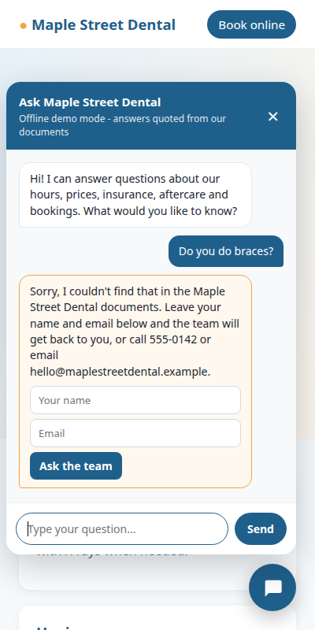

# Document Q&A Chatbot for Small Business Websites

**A chat bubble you add to any website with one `<script>` tag. It answers visitor questions from your own documents (PDF, Word, Markdown, text, web pages), streams the reply, cites the exact page, and collects the visitor's email when the answer is not in the documents.**


*Offline demo mode on a fictional dental practice. The visitor asks "Do you offer teeth whitening?" and then "How much is it?"; the bot understands the follow-up and quotes the price with a numbered citation. The source passage is expanded.*

<!-- After pushing to GitHub, add the badge:  -->

## Features

| | This project | Typical "PDF chatbot" demo |
|---|---|---|
| Embed on a client's site | One `<script>` tag, styles isolated in a Shadow DOM, colour/title/greeting/questions set by `data-` attributes | Separate page or iframe |
| Sources | Several PDFs, **DOCX**, Markdown, TXT and **web pages**, all in one index | One PDF |
| Answers | **Streamed** word by word (Server-Sent Events) | Wait for the full reply |
| Citations | Numbered **[1] [2]** inline, click to expand the source passage, with document, section and **page** | None, or a file name |
| Follow-up questions | Remembers the last turns of the conversation ("How much is **it**?") | Each question on its own |
| Visitor's language | AI mode replies in the language of the question and searches with an English rewrite | English only |
| Unknown questions | Says so, never guesses, and asks for **name + email** (saved as a lead) | Makes something up |
| Admin page | Upload/remove documents, add a web page, re-index, see **questions the bot could not answer** and leads | Edit files on the server |
| Abuse protection | Rate limit per visitor, "answer only from the documents" rules, prompt-injection filter, honeypot on the lead form | None |
| Works without an API key | Yes: offline mode quotes the best sentences from the documents | No |
| Deploy | `docker compose up`, or plain `python -m app.server` | Notebook |

## Architecture



## Quick start

Requirements: Python 3.10+, `pdftotext` (`sudo apt install poppler-utils` / `brew install poppler`), and `pip install -r requirements.txt` (requests, beautifulsoup4, lxml).

```bash
python -m app.server
```

- http://127.0.0.1:8000 - sample website with the chat bubble
- http://127.0.0.1:8000/?autoplay - watch it answer three sample questions by itself
- http://127.0.0.1:8000/admin - manage documents, see unanswered questions and leads

On the first start the files in `sample_docs/` are copied to `data/docs/`. Everything the admin page changes lives in `data/`.

**AI mode:** `cp .env.example .env`, put a `GEMINI_API_KEY` (or `OPENAI_API_KEY`) in `.env`, restart. Without a key, or if the AI call fails, the bot answers in offline mode automatically.

**Docker:**

```bash
docker compose up --build        # http://localhost:8000; set ADMIN_PASSWORD in .env to use /admin remotely
```

**Tests** (offline, no key needed):

```bash
python -m unittest discover tests
```

## Embed on any website

```html
<script src="https://your-server.example/widget.js"
        data-title="Ask Maple Street Dental"
        data-color="#1f5f8b"
        data-greeting="Hi! Ask me about prices, hours or bookings."
        data-chips="What are your opening hours?|How much is a root canal?"
        data-position="right"></script>
```

| Attribute | Meaning |
|---|---|
| `data-title` | Header text of the chat panel |
| `data-color` | Brand colour (hex) |
| `data-greeting` | First message |
| `data-chips` | Up to 4 suggested questions, separated by `\|` |
| `data-position` | `right` (default) or `left` |
| `data-open` | `true` to open the panel on page load |

Set `ALLOWED_ORIGINS` to the client's domain(s) so only their site can call the API from a browser.





## Configuration (`.env`)

| Variable | Default | Purpose |
|---|---|---|
| `GEMINI_API_KEY` / `GEMINI_MODEL` | - / `gemini-2.5-flash` | Google Gemini key and model |
| `OPENAI_API_KEY` / `OPENAI_MODEL` | - / `gpt-4o-mini` | OpenAI, used if no Gemini key is set |
| `BUSINESS_NAME`, `BUSINESS_CONTACT` | sample practice | Used in answers and in the "not in the documents" reply |
| `DATA_DIR` | `data` | Documents, cached web pages, unanswered questions, leads |
| `SEED_DIR` | `sample_docs` | Copied into `DATA_DIR/docs` on the very first start |
| `ADMIN_PASSWORD` | empty | Password for `/admin` (any user name). Empty = admin only from 127.0.0.1 |
| `RATE_LIMIT_PER_MINUTE` | `20` | Questions per visitor IP per minute (HTTP 429 above it) |
| `ALLOWED_ORIGINS` | `*` | Sites allowed to embed the widget (comma separated) |
| `TRUST_PROXY` | `0` | `1` behind nginx/Caddy so the rate limit uses `X-Forwarded-For` |
| `STREAM_DELAY_MS` | `25` | Offline mode typing speed (AI mode streams at the model's speed) |
| `HOST`, `PORT` | `127.0.0.1`, `8000` | Where the server listens |

Keys are read from the environment only and are never logged or sent to the browser.

## API

```
POST /api/ask          {"question": "How much is a root canal?", "session_id": "optional"}
-> {"answer": "Root canal treatment: from $650, depending on the tooth. [1]",
    "sources": [{"n": 1, "label": "Patient Guide - 4. Services and Prices, page 2",
                 "doc": "Patient Guide", "section": "4. Services and Prices", "page": 2,
                 "snippet": "...Root canal treatment: from $650, depending on the tooth..."}],
    "mode": "offline", "found": true, "offer_lead": false, "guarded": false, "session_id": "..."}

POST /api/ask/stream   same body; text/event-stream with events:
    meta {"mode"} -> token "text" (many) -> [replace "text"] -> done {same JSON as above}

POST /api/lead         {"name", "email", "question"}   (field "website" is a honeypot)
GET  /api/status       business, documents, chunk count, mode

Admin (Basic auth with ADMIN_PASSWORD, or localhost only):
GET  /api/admin/sources | /api/admin/unanswered | /api/admin/leads
POST /api/admin/upload?name=file.pdf   (raw file body, max 15 MB)
POST /api/admin/url      {"url": "https://..."}
POST /api/admin/remove   {"name": "file.pdf" or the URL}
POST /api/admin/reindex  {"refetch": true}   (true = download web pages again)
```

## How it works

1. **Loading** (`loaders.py`): PDFs via `pdftotext`, page by page; DOCX read directly from the ZIP/XML (heading styles become sections, page breaks are counted); Markdown `#` headings and numbered headings ("4. Prices") become sections; web pages are cleaned of navigation, scripts and footers. Everything is split into chunks of up to 120 words that remember document, section and page.
2. **Search** (`retriever.py`): a pure-Python BM25 index with light stemming and a small, editable synonym list ("cost" -> "price", "take" -> "accept").
3. **Follow-ups** (`memory.py`): each browser tab keeps its last 6 turns in server memory for 30 minutes (nothing on disk). Questions that point back ("it", "that", "they") are searched together with the previous topic; in AI mode the LLM rewrites them into a standalone English query, which also makes questions in other languages searchable.
4. **Answering** (`answerer.py`): weak matches are treated as "not in the documents". In AI mode the passages are sent as quoted, numbered data with strict rules (answer only from them, cite [n], same language as the visitor, `NOT_FOUND` otherwise) and the reply is streamed; the citation numbers in the reply decide which sources are shown. In offline mode the best sentences are quoted word for word. If the AI call fails before or during the stream, the bot falls back to offline mode or finishes with what it has.
5. **Guards**: rate limiting per IP, a prompt-injection filter that refuses "ignore your instructions"-style messages before any AI call, a 500-character question limit, and a honeypot plus email check on the lead form.
6. **Admin** (`library.py`, `/admin`): uploads are checked (allowed types, 15 MB, the file must be readable) before they are indexed; a web page that cannot be re-fetched keeps its previous copy and shows the error.

## What is tested and what is not

- `python -m unittest discover tests` runs the offline test suite: the four document formats, the URL loader against a local web server, answer quality on the sample documents, follow-ups, the injection filter, AI mode with a **mocked** LLM (streaming, citations, `NOT_FOUND`, non-English question, failure before and during the stream), the Gemini/OpenAI streaming parsers with mocked HTTP, and the real HTTP server (SSE, leads, honeypot, admin upload/URL/remove/re-index, admin password, rate limit, CORS).
- **Not verified here:** answers from a real Gemini/OpenAI key, building or running the Docker image, and the GitHub Actions run. Offline mode quotes the documents as they are written, so it does not translate; replies in the visitor's language need AI mode.

## Adapting it for a client

- Upload their price list, FAQ, policies and a couple of web pages on the admin page; set `BUSINESS_NAME`, `BUSINESS_CONTACT`, `ADMIN_PASSWORD`, `ALLOWED_ORIGINS`.
- Give them the one-line embed code with their colour and greeting.
- Add their own words to `SYNONYMS` in `retriever.py` (product names, local terms).
- Check the "questions the bot could not answer" list weekly and add the missing information to a document.
- For large document sets, replace BM25 with embeddings and a vector store; the citation, streaming and guard logic stay the same.

## Sample data

Everything in `sample_docs/` and `static/site/` describes **Maple Street Dental, a fictional practice**: names, prices and phone numbers are made up. The PDF is generated by `scripts/make_sample_pdf.py` (HTML converted with LibreOffice), the DOCX and Markdown files and the demo web page by `scripts/make_sample_docs.py`.

## File tree

```
pdf-chatbot/
├── app/
│   ├── server.py        # stdlib HTTP server: JSON + Server-Sent Events, admin API, CORS
│   ├── answerer.py      # AI / offline answers, numbered citations, guards
│   ├── library.py       # documents + web pages, add/remove/re-index
│   ├── loaders.py       # PDF, DOCX, MD, TXT, HTML -> chunks with page numbers
│   ├── retriever.py     # pure-Python BM25 search
│   ├── memory.py        # per-visitor conversation memory
│   ├── ratelimit.py     # sliding-window rate limiter
│   ├── store.py         # unanswered questions and leads (JSON Lines)
│   ├── llm.py           # Gemini / OpenAI client, normal and streaming
│   └── config.py        # settings from environment / .env
├── static/
│   ├── widget.js        # the embeddable widget
│   ├── admin.html/.js/.css
│   ├── index.html       # sample website
│   └── site/team.html   # sample web page for the "add a URL" feature
├── sample_docs/         # fictional practice: PDF, DOCX, Markdown
├── scripts/             # sample document generators
├── tests/               # offline tests
├── docs/                # screenshots
├── Dockerfile, docker-compose.yml, .github/workflows/tests.yml
└── .env.example
```
