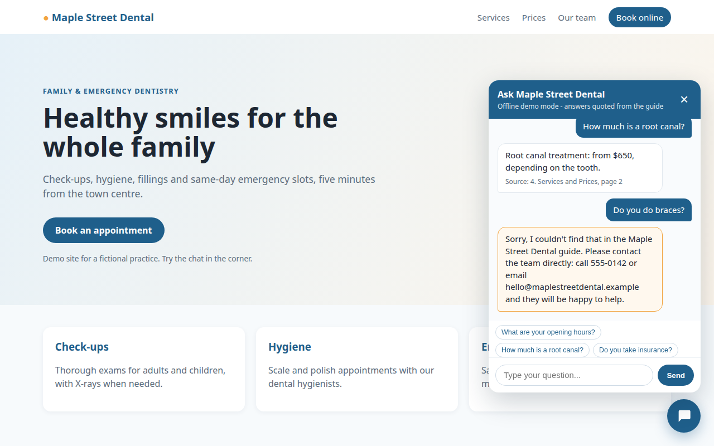

# PDF Q&A Chatbot for a Small Business Website

**A website chat bubble that answers visitor questions from your own PDF (price list, FAQ, policies) and cites the page it used.**



*Screenshot: the chat widget on a landing page for a fictional dental practice, running in offline demo mode. It answers a price question with a page citation and politely declines a question the guide does not cover.*

## Features

- **Drop-in chat widget** - floating bubble, suggested questions, mobile-friendly, plain HTML/CSS/JS (no framework).
- **Answers from your document only** - the PDF is split into sections, ranked with BM25 (the ranking method behind most search engines), and the best passages are used to answer.
- **Page citations** - every answer shows the section and page it came from, e.g. `4. Services and Prices, page 2`.
- **Guardrail** - if the answer is not in the document, the bot says so and gives the business's contact details instead of guessing.
- **Two modes**
  - **AI mode** - with `GEMINI_API_KEY` (Gemini 2.5 Flash) or `OPENAI_API_KEY` set, the LLM writes a short, friendly answer using only the retrieved passages.
  - **Offline demo mode** - no key needed; the most relevant sentences are quoted directly from the document.
- **Light footprint** - Python standard library HTTP server + `requests`; PDF text extraction with `pdftotext` (poppler-utils).

## Quick start (offline demo, one command)

Requirements: Python 3.10+, `pdftotext` (`sudo apt install poppler-utils` / `brew install poppler`), `requests`.

```bash
python -m app.server
```

Open http://127.0.0.1:8000 and click the chat bubble. Open http://127.0.0.1:8000/?autoplay to watch it ask three sample questions by itself.

To enable AI answers:

```bash
cp .env.example .env      # then put your GEMINI_API_KEY or OPENAI_API_KEY in .env
python -m app.server
```

Run the tests (offline):

```bash
python -m unittest discover tests
```

## Configuration (`.env`)

| Variable | Purpose |
|---|---|
| `GEMINI_API_KEY` / `GEMINI_MODEL` | Google Gemini key and model (default `gemini-2.5-flash`) |
| `OPENAI_API_KEY` / `OPENAI_MODEL` | OpenAI key and model, used if no Gemini key is set |
| `DOC_PATH` | PDF (or `.txt`, pages separated by form feeds) to answer from |
| `BUSINESS_NAME`, `BUSINESS_CONTACT` | Used in answers and in the "not in the document" fallback |
| `HOST`, `PORT` | Where the server listens |

Keys are read from the environment only and are never logged.

## API

```
POST /api/ask   {"question": "How much is a root canal?"}
-> {"answer": "Root canal treatment: from $650, depending on the tooth.",
    "sources": ["4. Services and Prices, page 2"], "mode": "offline", "found": true}
GET  /api/status -> business name, document, number of chunks, current mode
```

## How it works

1. `pdf_loader.py` runs `pdftotext`, splits the text by page and by numbered headings, and keeps the page number and section title with each chunk.
2. `retriever.py` builds a BM25 index (with light stemming and a small, editable synonym list such as "cost" -> "price").
3. `answerer.py` checks the best score against a threshold. Too low means "not in the document". Otherwise it either asks the LLM (passages + strict instructions) or quotes the best sentences.
4. `server.py` serves the landing page, widget and JSON API.

## Adapting it for a client

- Swap in the client's PDFs (several documents can be indexed by extending `load_document`).
- Restyle the widget with the client's colours in `static/style.css` and embed it on their site via a `<script>` tag or iframe.
- Add their own synonyms (product names, local terms) to `SYNONYMS` in `retriever.py`.
- For larger document sets: replace BM25 with embeddings (Gemini/OpenAI embeddings + a vector store), keep the same citation and guardrail logic.
- Production extras: rate limiting, conversation logging to a Google Sheet for review, an "email this to staff" hand-off, deployment behind HTTPS (e.g. a small VPS, Render or Cloud Run).

## Sample document

`sample_docs/maple-street-dental-guide.pdf` is a 3-page guide for **Maple Street Dental, a fictional practice** - all names, prices and phone numbers are made up. It is generated by `scripts/make_sample_pdf.py` (HTML converted with LibreOffice headless).

## File tree

```
pdf-chatbot/
├── app/
│   ├── server.py        # stdlib HTTP server + JSON API
│   ├── answerer.py      # AI / offline answers, citations, guardrail
│   ├── retriever.py     # pure-Python BM25 search
│   ├── pdf_loader.py    # pdftotext extraction + section chunking
│   ├── llm.py           # Gemini / OpenAI REST client (requests)
│   └── config.py        # settings from environment / .env
├── static/              # landing page, chat widget CSS and JS
├── sample_docs/         # fictional clinic guide (PDF)
├── scripts/make_sample_pdf.py
├── tests/test_chatbot.py
├── docs/screenshot.png
├── .env.example
└── requirements.txt
```
